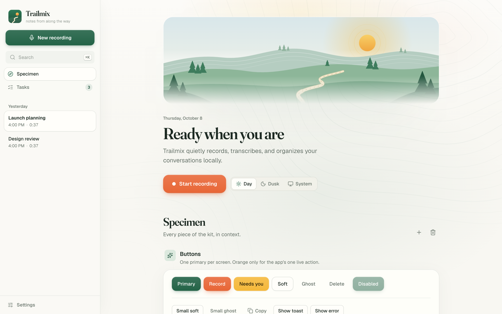
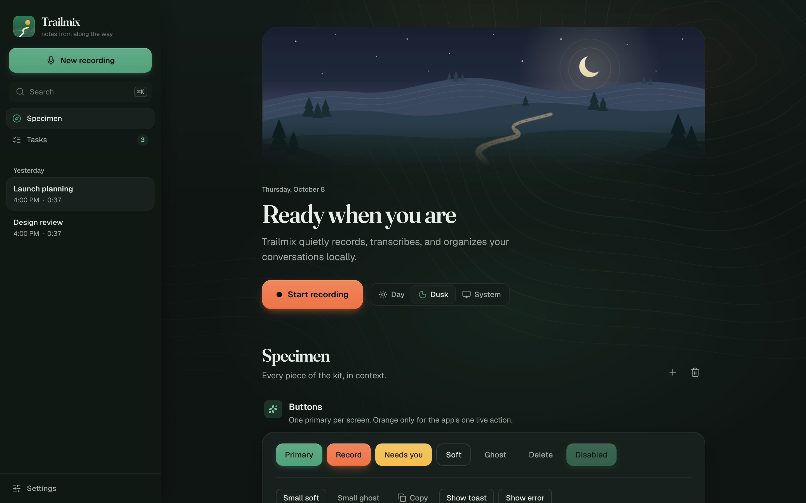

# Trailmix Design Family

Everything a new app needs to be a sibling of Trailmix: how it looks, moves and talks, and how it's built
underneath, so that the family's apps can one day become one app with each of them as an add-on.

- **`DESIGN.md`** is the design guide: the idea, tokens, type, layout, components, motion, illustration, voice,
  and the do and don't list.
- **`starter/`** is the architecture template, and where new apps start. It's a working app: the shared host
  (server, database, settings, background jobs, AI providers, search, sign-in, web shell, Mac app) plus two
  example modules that work together. Its **`ARCHITECTURE.md`** explains how it fits together and the rules
  that keep apps combinable.
- **`kit/`** is the design kit on its own: every token and component on one sample page. The starter already
  includes it; use the kit to add the look to an app that isn't built on the starter.
- **`reference/`** holds Trailmix's original files, unchanged.
- **`assets/`** holds the mark and screenshots to compare against.

## Start a new family app

Start from `starter/`. Its [README](starter/README.md) has the steps:

1. Copy the folder and edit `app.json`.
2. Run `scripts/new-module`.
3. Run `scripts/dev`.

Copy `DESIGN.md` next to it, so the links in `ARCHITECTURE.md` (`../DESIGN.md`) keep working.

**Only want the look, in an existing React + Tailwind 3 app?**

1. Copy `kit/src/index.css`, `kit/tailwind.config.js`, `kit/src/theme.ts` and `kit/src/components/`.
2. Add the dependencies from `kit/package.json` and the font imports from `kit/src/main.tsx`.
3. Call `useTheme()` once at the root.

`kit/` also runs on its own (`npm install`, then `npm run dev`) to show the sample page above.

## Prompt for an AI agent

> This app is part of the Trailmix family. Before changing anything, read DESIGN.md and
> starter/ARCHITECTURE.md in full (in a project made from the starter: ARCHITECTURE.md and ../DESIGN.md).
> Build features as modules, following modules/notes. Use the kit's tokens, classes and components instead of
> new styles, design every screen for both Day and Dusk, never import one module from another, and run
> scripts/check before you finish.
